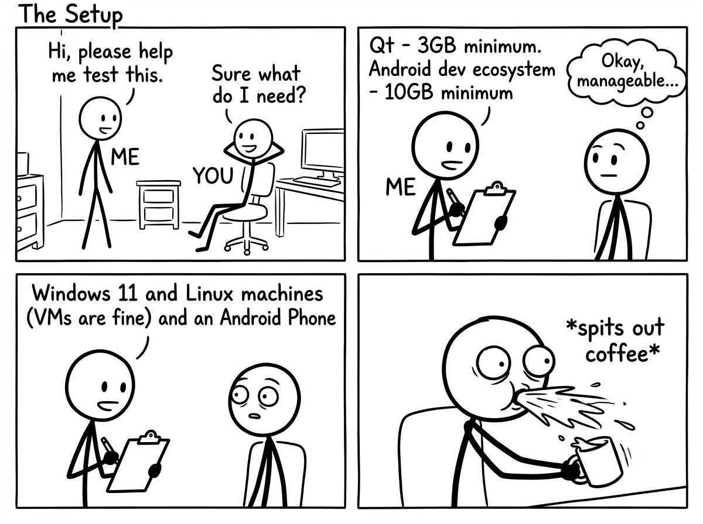

Virtual GamePad is five projects that work as one:

1. the phone app that is your controller,
2. the PC server that turns that input into a virtual gamepad,
3. the shared language they speak,
4. this website, and
5. the builder that turn all of this into downloads. (Private, so that I can experiment without fear of leaking encryption keys.)

All of it has **one maintainer** - me.

After several months with little activity, this week was a deliberate attempt to take stock, reduce the fear of touching things, and clear the ground so the next changes --- the ones you would actually feel --- can happen.

## Where things stood

On October 15 I went through every one of them and wrote down what I found.

The PC server and the website were current. The Android app was not: its latest upgrades --- the kind of update that can break every future build --- were **finished but sitting unpublished for two months**. Why wait so long? Because with no automated tests, you cannot prove an upgrade is safe. You break it in secret, or you don't touch it. So it waits until "after the release". And the release never quite comes.

Meanwhile the requests and bug reports had piled up, waiting for answers.

The main obstacles were not code. Setting up the Android and PC development tools takes a long time, nothing was automated, and every change was checked by hand --- by playing a real game with a phone in my hand. That also makes every change feel risky.

### The unholy setup

_To add insult to injury, the binaries produced are only <10MB each._

## What changed

One of the changes you can feel right away. The rest is groundwork. Bear with the groundwork: it decides when the next feature ships.

### What you will notice

- The phone screen can now stay awake while the app is your controller, so it does not black out mid-game. This was a community contribution; I reviewed and tested it, and it is merged into the app's next release.
- The desktop server refuses to start with a clear message if you place it in a folder it cannot write to, e.g., somewhere in Program Files. Before, it would start fine and silently forget your settings.
- On Linux, the instructions for granting the permissions the server needs are clearer and no longer point to a developer document.
- Website got a blog section which serves this post you are reading. ;)

### Under the hood

This is the part that makes the next update faster and safer:

- Both apps can now be built, checked and tested with one command. No more "works on my machine, probably".
- For developers, I've added pull request templates to the PC and Mobile repos.
- [`mise`](https://mise.jdx.dev/) is now our task runner, so common commands are documented and runnable in one step. Including the ones I kept forgetting.

## Wishlist

- Flatpak for Linux. This is another item on which work started months ago but was never finished.
- Automated end-to-end tests, so one day a change can be verified without me playing a game.

The "last modified" dates on these pages and this blog are new too --- refresh often, or use your favorite feed reader.

Nothing here makes the app do anything new --- except one setting. Everything else worked on the part you do not see: whether the next feature ships in a few weeks, or waits another two months. The fear of touching things is not gone. But now it has something to argue with.
