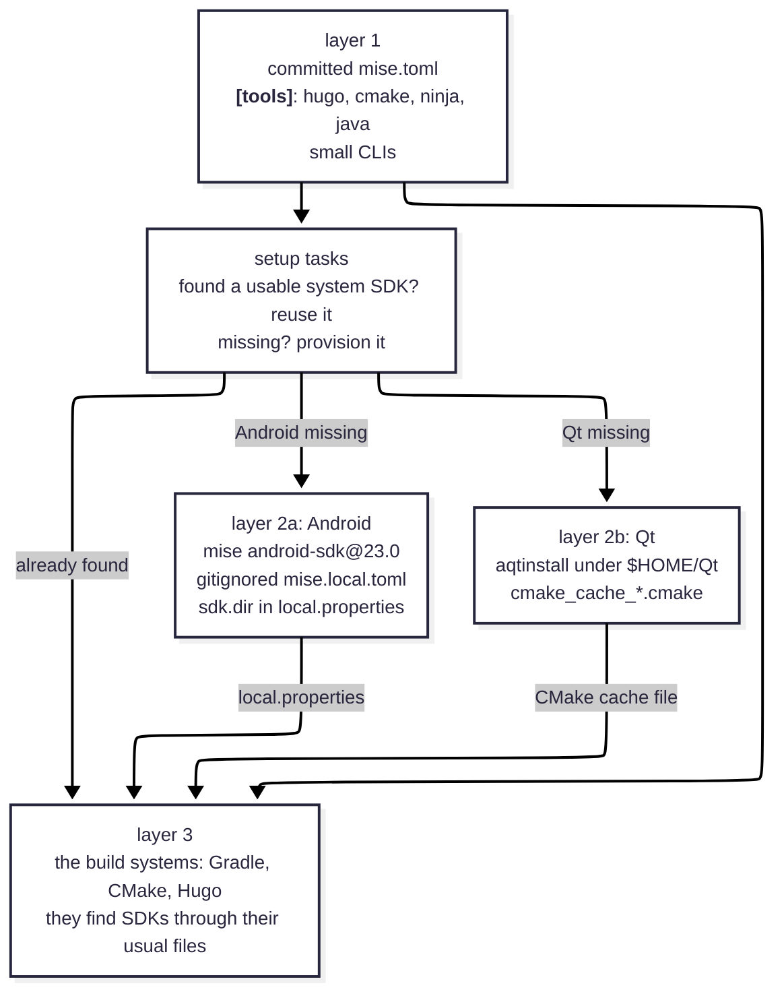

[The first VirtualGamePad devlog](devblog-2026-10-18.md) celebrated [mise](https://mise.jdx.dev/) as a task runner. That was the small half.

Now, I'll show you how to build the other half: a setup where each repo pins the small tools, checks for heavyweight SDKs, and provisions only what is missing.  
A new contributor can run the build task instead of hunting down every tool by hand; a few OS prerequisites still need to be installed separately.  
VirtualGamePad is modular by design - a specialist with existing tools can clone and build a single component.  
This setup aims to lower the barrier to entry, reduce errors, and promote work across components.

Let's lay down our requirements first:

| | What we want | Why |
| :--- | --- | --- |
| 1. | Setup reuses a detected system installation. If a contributor already has the Android SDK or Qt installed, mise should detect it and use it. | No repeated resouce usage. |
| 2. | mise should be invisible to the build systems. | Prevents tight coupling. Don't fix what isn't broken. |
| 3. | Quick setup on fresh systems. | Run command, let it finish, continue. |

1. Setup reuses a detected system installation. If a contributor already has the Android SDK or Qt installed, mise should detect it and use it. No repeated resouce usage.
2. mise should be invisible to the build systems. Prevents tight coupling. Don't fix what isn't broken.
3. Quick setup on fresh systems. Run command, let it finish, continue.

"Meta-manager" because mise does not build anything itself. It stands above the build tools - Gradle, CMake, Hugo - and helps provide the versions the project expects.

## The problem, in four lines

In my previous post, there's a comic 

> **Me:** Hi, please help me test this.
>
> **You:** Sure, what do I need?
>
> **Me:** Qt - 3 GB minimum. Android dev ecosystem - 10 GB minimum. Windows 11 and Linux machines (VMs are fine) and an Android phone.
>
> **You:** *spits out coffee*

What you want instead is a conversation that starts: "install mise, then run the build task." To get there, the answers to "what do I need?" and "install it for me" have to live in the repo, not in human memory. Mise keeps each repo's toolchain predictable without turning the whole ecosystem into one giant install; OS prerequisites remain in the platform-specific build instructions.

| Tool | Earlier | Now |
| --- | --- | --- |
| Qt | Install by hand, using the online installer. Pray that you picked the right subset of items in the GUI. (All is 20GB, minimal via custom install is 2GB) | `mise run setup` |
| CMake, Ninja | Multiple ways - bundled with Qt, from a package manager - you probably have multiple versions and no idea which is used | `mise install` |
| Android SDK | Again, download Android Studio, fiddle with buttons and navigate a maze of popups to get a working setup | `mise run setup` |
| Java | Use a package manager, get version conflicts, reconsider your life choices | `mise install` |
| Hugo | Use a package manager or download binary manually | `mise install` |

Here's the architecture that does it.

## The architecture: three layers



- **Layer 1 - pinned CLIs in the committed `mise.toml`.** Small, cheap, always wanted: `hugo`, `cmake`, `ninja`, `java`. Java is pinned to a major line; the other entries use exact versions.
- **Layer 2 - heavyweight SDKs, provisioned only when missing.** Android is declared in the checkout's gitignored `mise.local.toml`; Qt is installed under `$HOME/Qt` by `aqtinstall`. When provisioning, each setup task records the location in the file its build system already reads; detected system paths are reused as-is.
- **Layer 3 - the build systems, untouched.** Gradle still reads `local.properties`; CMake still reads its cache file. That's the trick: mise never needs to re-point them at anything.

## Step 1: pin the small CLIs

Open `mise.toml` in your repo and declare what your build *commands* need:

```toml
[tools]
java = "21"          # Mobile
# cmake = "4.4.4"    # PC
# ninja = "1.13.2"   # PC
# hugo = "0.161.0"   # this website
```

Rationale: these are version requests, not ice sculptures. `java = "21"` selects a Java 21 release managed by mise; it pins the major line, not an exact patch build. CMake, Ninja and Hugo have exact version entries. Pin versions that have already built the project successfully, and match CI where it specifies a version. On the website repo, `hugo = "0.161.0"` is the exact string the CI workflow uses for `HUGO_VERSION` - one source of truth for that question.

Then run:

```sh
mise install        # fetches and activates the pinned CLIs
mise ls --current   # verify: which config each tool came from
```

## Step 2: decide what mise may *never* claim

The Android SDK and Qt are where a tutorial has a fork in the road, and the wrong path looks shorter. The tempting move:

```sh
mise use android-sdk@23.0     # ❌ do not commit this
```

Two reasons, both discovered the hard way:

1. On a machine with a system Android SDK (like mine), mise downloads a parallel ~155 MB copy nobody asked for.
2. mise sets `ANDROID_HOME` to that mise copy inside every task - so Gradle launched through mise can use a different SDK than the one configured for the rest of your machine. A "convenience" tool should not change where your builds go.

So the committed file stays honest and quiet about heavyweight SDKs:

```toml
[tools]
java = "21"    # ...and nothing else in the Android repo
```

## Step 3: detect before you provision

Write a `setup` task that first looks for the tool the way the *build system* would look for it, not the way mise would. For Android, Gradle's own discovery order is what matters most:

```sh
# what Gradle reads first, so read that first:
sdk="$(sed -n 's/^sdk\.dir=//p' local.properties 2>/dev/null || true)"
# then the environment, same as anywhere else:
sdk="${sdk:-${ANDROID_HOME:-$ANDROID_SDK_ROOT}}"
```

The two `|| true` / `:-` fallbacks matter more than they look. On Linux, assignment commands inherit the exit status of the command substitution; without the `|| true`, `sh -o errexit` (mise's default shell) kills your script the moment `local.properties` doesn't exist - which is precisely the fresh-clone case this task exists for. My first draft died this way; a code review caught it.

Booking the found case, setup just says so and stops: nothing to install.

```sh
if [ -d "$sdk" ]; then
  echo "Using existing Android SDK: $sdk"
  exit 0
fi
```

## Step 4: provision only what's missing

When the SDK genuinely isn't there, provision into mise's own directory - but *declare* it, using `--env local`:

```sh
mise use --env local android-sdk@23.0
```

That one command does three things: downloads the tool, records it in `mise.local.toml`, and (from next run on) puts `sdkmanager`, `avdmanager`, the new `android` CLI and the platform tools on PATH for every task in this checkout - while staying invisible to git and to everyone else's machines.

Two follow-ups keep a build from dying two minutes later:

```sh
mise exec android-sdk@23.0 -- \
  sdkmanager --licenses         # the first gradle build will fail without licenses
mise exec android-sdk@23.0 -- \
  sdkmanager platform-tools     # adds adb; the plugin auto-PATHs it if present
printf 'sdk.dir=%s\n' "$(mise where android-sdk@23.0)" > local.properties
```

`local.properties` is already gitignored, and Gradle prefers it over any `ANDROID_HOME` - so the project keeps building against exactly what this task set up, deterministically. (On Windows the equivalent lines escape the path the same way Gradle expects; check the repo's `mise.toml` if you want the full copy-paste.)

## Step 5: wire the tasks that need it

Don't make people remember to run setup; make tasks depend on it:

```toml
[tasks.build]
depends = ["setup"]                 # runs once per invocation when needed
run = "./gradlew assembleDebug"

[tasks.check]
depends = ["setup"]
run = "./gradlew build lint test"
```

And keep a `doctor` task that *reports only*:

```toml
[tasks.doctor]
description = "Check prerequisites (detect only - never installs anything)"
run = "java -version && [... SDK detection ...]"
```

It checks and says where each piece of the toolchain lives, or which setup task to run. A "doctor" that mutates your machine should alarm you; keep the pipeline: `mise run doctor` to understand, `mise run build` to get everything.

## Step 6: what mise can't manage gets a fallback

Qt has no mise backend worth using, and its installer downloads are developer-installer-sized. The PC repo's fallback provisions it with `aqtinstall` - the command-line installer GitHub Actions already uses. These are the provisioning commands; setup runs the matching platform commands only when it cannot find a usable Qt install:

```sh
aqt='git+https://github.com/miurahr/aqtinstall.git@8c3695d4a4e1ceabf6a74dc6c79681656dc6b74b'

# Windows: Qt plus its matching MinGW compiler
mise exec uv@latest -- uvx --from "$aqt" aqt install-qt windows desktop 6.11.0 win64_mingw -O "$HOME/Qt"
mise exec uv@latest -- uvx --from "$aqt" aqt install-tool windows desktop tools_mingw1310 -O "$HOME/Qt"

# Linux
mise exec uv@latest -- uvx --from "$aqt" aqt install-qt linux desktop 6.11.0 linux_gcc_64 -O "$HOME/Qt"
```

The point is not just the incantation, it's what setup produces: the same `cmake_cache_<platform>.cmake` file a human has been writing by hand all along. For the *human path*, the Qt installer approach still works exactly as documented - the fallback is in addition, not instead. (The commit pin exists because aqt's released version can't read Qt's new 6.11+ package layout; the CI workflow documents the same fact.)

## The result

After installing mise, cloning the repo, and installing any listed OS prerequisites, the remaining steps are:

```sh
mise install       # install the small, pinned tools
mise run doctor    # what do I have? what's missing?
mise run build     # set up missing SDKs, then build
```

For VirtualGamePad-PC, clone with submodules; Linux also needs a C++ compiler and `libevdev-dev` (see [Build.md](https://github.com/kitswas/VirtualGamePad-PC/blob/main/Build.md) for the package prerequisite). Device tasks in the Android repo also need a connected phone or emulator. On this website's repo, setup is unnecessary - `hugo` is pinned. The repo task definitions implement this policy for both sh and PowerShell; the snippets here show the key commands, not a replacement for those complete tasks.

### Two detours worth knowing before you try this

- **cmdline-tools 23 is deprecating its own CLI.** `sdkmanager` now prints that the new `android` CLI replaces it, and even warns that `--licenses` is no longer needed. The scripts keep the old names so older tool versions still work; both warnings are harmless noise for now.
- **A provisioned machine keeps its choice.** Once a checkout uses its mise-owned Android SDK, it keeps that choice even if a system SDK appears later. To switch, remove the `sdk.dir` entry from `local.properties` (or point it at the new SDK), delete `mise.local.toml`, then re-run `mise run setup`.

Nothing in this pass upgraded Gradle, AGP or CMake - that's the final layer of defense: a meta-manager makes the boring decisions automatic so the interesting ones (renovate the build system? bump Kotlin?) stay deliberate.
