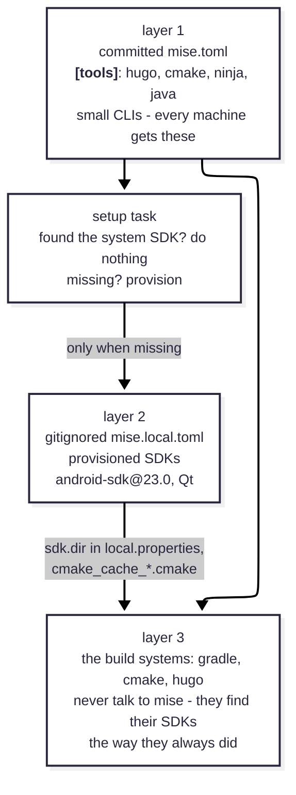

[The first VirtualGamePad devlog](devblog-2026-10-18.md) celebrated [mise](https://mise.jdx.dev/) as a task runner. That was the small half.  
Now, I'll show you how to build the other half: a setup where every repo declares its toolchain to mise, and a fresh dev goes from "spits out coffee" to a passing build without assistance.

One rule carries the whole design:

> **The system tool wins when it is there. mise installs only when nothing is found.**

"Meta-manager" because mise does not build anything itself. It stands above the build tools - Gradle, CMake, Hugo - and makes sure the version you get is the version the project was last verified with.

## The problem, in four lines

In my previous post, there's a comic 

> **Me:** Hi, please help me test this.
>
> **You:** Sure, what do I need?
>
> **Me:** Qt - 3 GB minimum. Android dev ecosystem - 10 GB minimum. Windows 11 and Linux machines (VMs are fine) and an Android phone.
>
> **You:** *spits out coffee*

What you want instead is a conversation that starts: "install mise, then run one command." To get there, the answers to "what do I need?" and "install it for me" have to live in the repo, not in human memory.  

| Tool | Earlier | Now |
| --- | --- | --- |
| Qt | Install by hand, using the online installer. Pray that you picked the right subset of items in the GUI. (All is 20GB, minimal via custom install is 2GB) | `mise run setup` |
| CMake, Ninja | Multiple ways - bundled with Qt, from a package manager - you probably have multiple versions and no idea which is used | `mise install` |
| Android SDK | Again, download Android Studio, fiddle with buttons and navigate a maze of popups to get a working setup | `mise run setup` |
| Java | Use a package manager, get version conflicts, reconsider your life choices | `mise install` |
| Hugo | Use a package manager or download binary manually | `mise install` |

Here's the architecture that does it.

## The architecture: three layers



- **Layer 1 - pinned CLIs in the committed `mise.toml`.** Small, cheap, always wanted: `hugo`, `cmake`, `ninja`, `java`. Every machine gets exactly these versions, always.
- **Layer 2 - heavyweight SDKs, never declared up front.** Android SDK, Qt. These flow in only when a machine lacks them, and only into that machine's gitignored `mise.local.toml`.
- **Layer 3 - the build systems, untouched.** Gradle still reads `local.properties`; CMake still reads its cache file. That's the trick: mise never needs to re-point them at anything.

## Step 1: pin the small CLIs

Open `mise.toml` in your repo and declare what your build *commands* need:

```toml
[tools]
java = "21"          # Mobile
# cmake = "4.4.4"    # PC
# ninja = "1.13.2"   # PC
# hugo = "0.161.0"   # this website
```

Rationale: these are version requests, not ice sculptures. `java = "21"` means "any 21.x" - mise takes what you have or fetches one. Whatever you pin, pin the version you have *already built with* (matching what CI or your contributors run), otherwise you have just guaranteed a fresh clone behaves differently from the machine that last shipped a release. On the website repo, `hugo = "0.161.0"` is the exact string the CI workflow uses for `HUGO_VERSION` - one source of truth for that question.

Then run:

```sh
mise install        # fetches and activates the pinned CLIs
mise ls --current   # verify: which config each tool came from
```

## Step 2: decide what mise may *never* claim

The Android SDK and Qt are where a tutorial has a fork in the road, and the wrong path looks shorter. The tempting move:

```sh
mise use android-sdk@23.0     # ❌ do not commit this
```

Two reasons, both discovered the hard way:

1. On a machine with a system Android SDK (like mine), mise downloads a parallel ~155 MB copy nobody asked for.
2. mise sets `ANDROID_HOME` to that mise copy inside every task - silently repointing an environment that Gradle and Android Studio were already pointing somewhere sensible. A "convenience" tool should not change where your files go.

So the committed file stays honest and quiet about heavyweight SDKs:

```toml
[tools]
java = "21"    # ...and nothing else in the Android repo
```

## Step 3: detect before you provision

Write a `setup` task that first looks for the tool the way the *build system* would look for it, not the way mise would. For Android, Gradle's own discovery order is what matters most:

```sh
# what Gradle reads first, so read that first:
sdk="$(sed -n 's/^sdk\.dir=//p' local.properties 2>/dev/null || true)"
# then the environment, same as anywhere else:
sdk="${sdk:-${ANDROID_HOME:-$ANDROID_SDK_ROOT}}"
```

The two `|| true` / `:-` fallbacks matter more than they look. On Linux, assignment commands inherit the exit status of the command substitution; without the `|| true`, `sh -o errexit` (mise's default shell) kills your script the moment `local.properties` doesn't exist - which is precisely the fresh-clone case this task exists for. My first draft died this way; a code review caught it.

Booking the found case, setup just says so and stops: nothing to install.

```sh
if [ -d "$sdk" ]; then
  echo "Using existing Android SDK: $sdk"
  exit 0
fi
```

## Step 4: provision only what's missing

When the SDK genuinely isn't there, provision into mise's own directory - but *declare* it, using `--env local`:

```sh
mise use --env local android-sdk@23.0
```

That one command does three things: downloads the tool, records it in `mise.local.toml`, and (from next run on) puts `sdkmanager`, `avdmanager`, the new `android` CLI and the platform tools on PATH for every task in this checkout - while staying invisible to git and to everyone else's machines.

Two follow-ups keep a build from dying two minutes later:

```sh
mise exec android-sdk@23.0 -- \
  sdkmanager --licenses         # the first gradle build will fail without licenses
mise exec android-sdk@23.0 -- \
  sdkmanager platform-tools     # adds adb; the plugin auto-PATHs it if present
printf 'sdk.dir=%s\n' "$(mise where android-sdk@23.0)" > local.properties
```

`local.properties` is already gitignored, and Gradle prefers it over any `ANDROID_HOME` - so the project keeps building against exactly what this task set up, deterministically. (On Windows the equivalent lines escape the path the same way Gradle expects; check the repo's `mise.toml` if you want the full copy-paste.)

## Step 5: wire the tasks that need it

Don't make people remember to run setup; make tasks depend on it:

```toml
[tasks.build]
depends = ["setup"]                 # runs once per invocation when needed
run = "./gradlew assembleDebug"

[tasks.check]
depends = ["setup"]
run = "./gradlew build lint test"
```

And keep a `doctor` task that *reports only*:

```toml
[tasks.doctor]
description = "Check prerequisites (detect only - never installs anything)"
run = "java -version && [... SDK detection ...]"
```

It checks and says where each piece of the toolchain lives, or which setup task to run. A "doctor" that mutates your machine should alarm you; keep the pipeline: `mise run doctor` to understand, `mise run build` to get everything.

## Step 6: what mise can't manage gets a fallback

Qt has no mise backend worth using, and its installer downloads are developer-installer-sized. The PC repo's fallback provisions it with `aqtinstall` - the command-line installer GitHub Actions already uses:

```sh
mise exec uv@latest -- uvx \
  --from "git+https://github.com/miurahr/aqtinstall.git@<pinned-commit>" \
  aqt install-qt windows desktop 6.11.0 win64_mingw -O "$HOME/Qt"
```

The point is not the incantation, it's what it produces: the same `cmake_cache_<platform>.cmake` file a human has been writing by hand all along. For the *human path*, the Qt installer approach still works exactly as documented - the fallback is in addition, not instead. (The commit pin exists because aqt's released version can't read Qt's new 6.11+ package layout; the CI workflow documents the same fact.)

## The result

From a bare clone, the whole conversation shrinks to:

```sh
# 1. install the version manager (any package manager; https://mise.jdx.dev)
# 2. go into the repo
mise run doctor    # what do I have? what's missing?
mise run build     # fetches only what's missing, then builds
```

On this website's repo, step 3 is redundant - `hugo` is 100 MB and always pinned. On VirtualGamePad-PC and VirtualGamePad-Mobile it is all three layers at once. Each repo's `mise.toml` is the executable version of this post: same layers, same rationale, full copy-paste for both sh and PowerShell.

### Two detours worth knowing before you try this

- **cmdline-tools 23 is deprecating its own CLI.** `sdkmanager` now prints that the new `android` CLI replaces it, and even warns that `--licenses` is no longer needed. The scripts keep the old names so older tool versions still work; both warnings are harmless noise for now.
- **A provisioned machine keeps its choice.** Once a machine uses its mise-owned Android SDK, it prefers that copy even if a system SDK appears later. That's by design - consistent beats clever - but if it surprises you, delete `mise.local.toml` and re-run `mise run setup` after the system SDK is installed.

Nothing in this pass upgraded Gradle, AGP or CMake - that's the final layer of defense: a meta-manager makes the boring decisions automatic so the interesting ones (renovate the build system? bump Kotlin?) stay deliberate.
